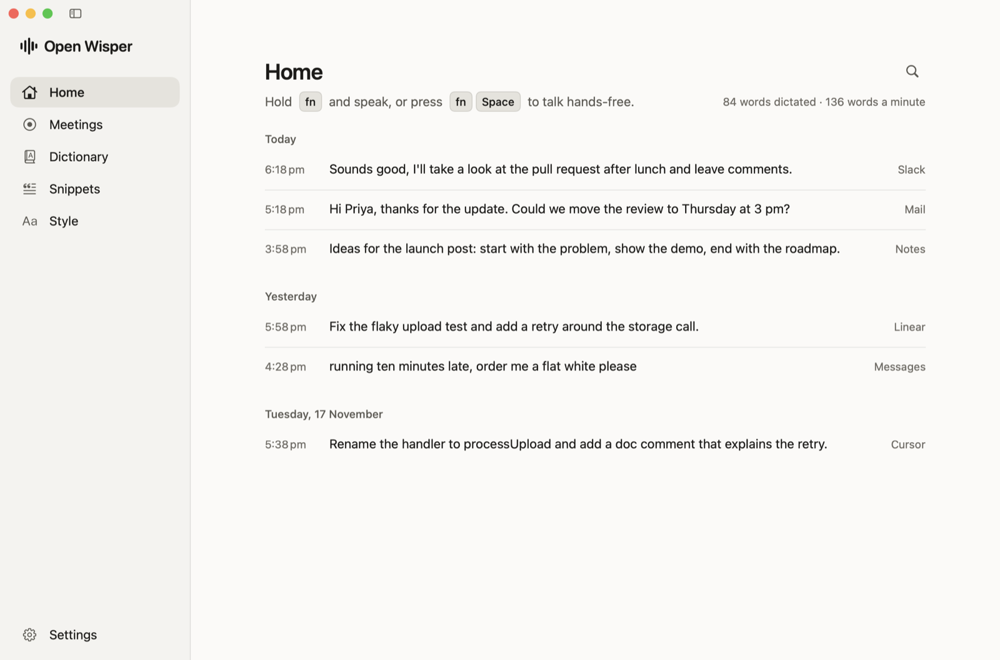
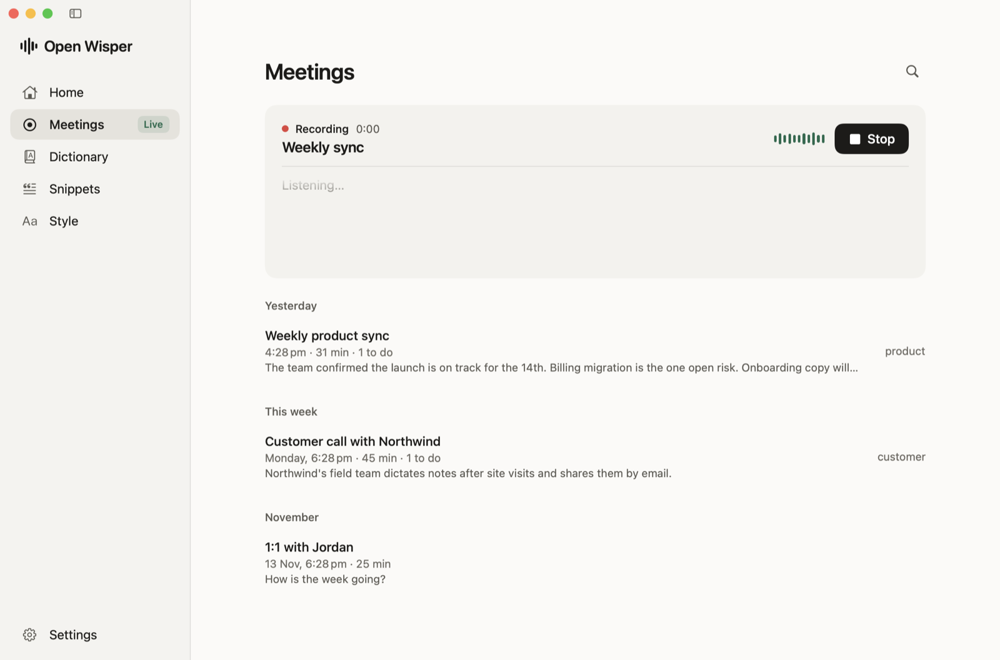
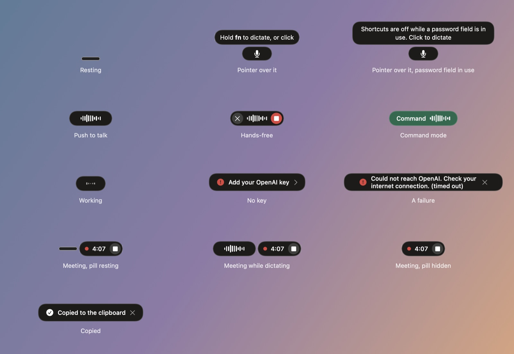
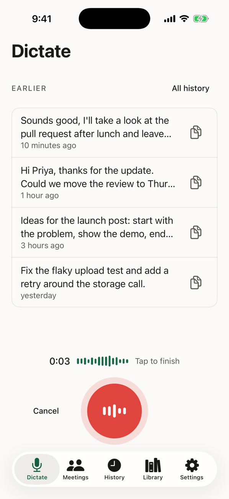
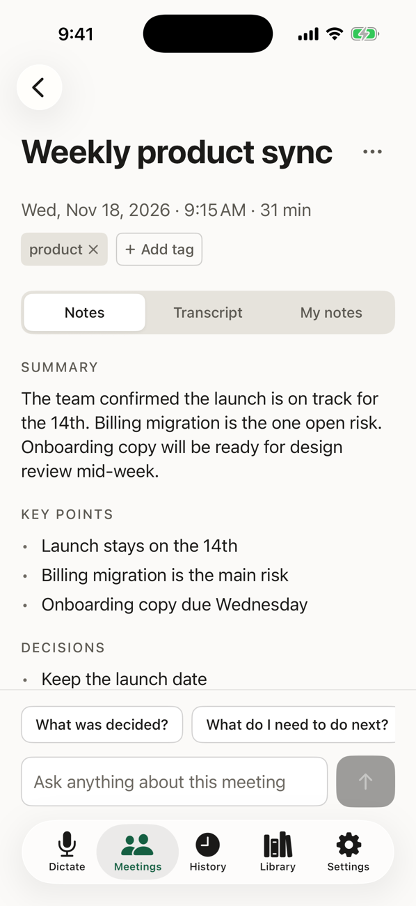

# Spaces

[](https://github.com/arjunkambj/open-spaces/actions/workflows/ci.yml)
[](LICENSE)

Spaces is a free, open-source app for macOS and iOS that turns your voice into text. Hold a key, speak, and clean text appears in whatever app you are typing in; it can also record your meetings and write the notes.

**Website and download: [whisper.0xhoney.com](https://whisper.0xhoney.com)**



| Recording a meeting | The floating pill, in each state |
| --- | --- |
|  |  |

<p align="center">
  
  &nbsp;&nbsp;
  
</p>

All pictures show made-up sample data.

> **Status: early.** This is a first version. Some things will be rough or broken. The macOS app is the main focus. The iOS app is newer and less tested. The Mac download is not checked by Apple, so macOS asks you to allow it the first time (see [Install](#install)). Bug reports are welcome.

Spaces is an independent open-source project. It is not affiliated with Wispr Flow.

## What it does

**Dictation**

- **Dictate anywhere.** Hold a key, talk, let go. The text is typed into the app you are using.
- **Hands-free mode.** Press once to start, press again to stop. Good for long thoughts.
- **Command mode.** Select some text, hold a key, and say how to change it ("make this shorter"). Save a command you use often as a snippet, then just say its phrase.
- **A small pill at the edge of the screen.** It shows when Spaces is listening. Click it to dictate, or drag it to any edge; on a side edge it stands upright.
- **Personal dictionary.** Teach it names and words it keeps getting wrong.
- **Snippets.** Say a short phrase ("my calendar link") and get a longer piece of text. In command mode, the text is your command instead.
- **Writing style per kind of app.** Formal in email, casual in chat. You choose.
- **History.** See what you dictated, search it, and see how many words you have dictated and how fast you speak.
- **Your words are not lost.** If a dictation fails, its audio is kept and you can try it again from Home. (If you told the app not to keep history, nothing is kept.)

**Meetings**

- **Record a meeting.** It records your microphone and what your Mac plays, so both sides of a call are captured.
- **Transcript with speakers.** Lines are marked "Me" or "Others".
- **AI notes.** A summary, key points, decisions and action items, written when the meeting ends.
- **Ask about a meeting.** Ask a question and get an answer from that meeting's transcript and notes.
- **Markdown export.** Copy, share or save a meeting as a Markdown file.
- **Safe from a crash.** If the app closes in the middle of a meeting, the audio is kept. The next time you open the app, it finishes the meeting from that audio.

**Everything else**

- **Works with your AI agent.** A command-line tool and an MCP server let an agent such as Claude read your meetings and notes and add to them. (MCP is a common way for AI agents to use outside tools.)
- **iPhone app with a keyboard.** Tap, speak, and the text is on your clipboard. The app's keyboard has a Dictate key and a key that types your latest dictation, so you can use it from any app. The iPhone app records meetings too.
- **Use your own server.** Point it at any server that speaks the same language as OpenAI's, such as a proxy or a model running on your own machine.

## Install

For a Mac with Apple silicon and macOS 14.4 or newer.

1. Download [`Spaces.dmg`](https://github.com/arjunkambj/open-spaces/releases/latest/download/Spaces.dmg), the newest version. Every version is on the [releases page](https://github.com/arjunkambj/open-spaces/releases).
2. Open the file and drag **Spaces** onto **Applications**.
3. Open it from Applications. The first time, macOS stops it and says it could not check the app. Click **Done**.
4. Open **System Settings → Privacy & Security**, scroll down to **Security**, and click **Open Anyway** next to the line about Spaces. The button is there for about an hour after step 3.
5. macOS asks once more. Confirm, and type your Mac password.

You do steps 3 to 5 only once. macOS asks because the app is not signed with an Apple developer certificate, which costs money each year. Apple has not checked it. If you would rather not run such an app, [build it yourself](#build-and-run) from the code on this page.

After that the app asks for your name, your OpenAI API key and a few [permissions](#permissions-on-first-run).

There is no iPhone download. To use the iPhone app, [build it with Xcode](#iphone).

## Updates

Spaces keeps itself up to date.

- **It checks by itself, about once a day.** When there is a new version, a window shows what changed and asks whether to install it. Nothing is installed without your yes.
- **You can check any time.** Choose **Check for Updates…** from the Spaces menu, from its menu bar item, or in Settings.
- **Your permissions and settings stay.** Every version is signed with the same certificate, so macOS knows it is the same app. You do not have to allow the microphone or Accessibility again.
- **Only a real update is installed.** Each release is signed with a key that only the project holds. The app checks that signature before it opens a download, and refuses anything that does not match. This holds even if someone took over the download page.

The check asks GitHub, where the releases are, for a small file that lists the newest version. It sends the app's name and version, and nothing about you or what you dictate. To turn the daily check off, run this once in Terminal. You can still check from the menu.

```bash
defaults write dev.openspaces.mac SUEnableAutomaticChecks -bool false
```

An app you built yourself does not look for updates. See [Build and run](#build-and-run).

## How it works

1. You speak. Spaces records the audio on your device.
2. While you talk, the audio goes to OpenAI, using **your own API key**. OpenAI writes the words as they come, so they are ready about a second after you stop.
3. A second, quick request tidies the text: it removes "um" and "uh", fixes punctuation, and applies your writing style. You can turn this off.
4. The text is typed into your app.

Meetings work the same way: the audio is turned into text piece by piece while you talk, and the notes are written when you stop.

Out of the box, Spaces asks for the model `gpt-live-transcribe` to turn speech into text while you talk, and `gpt-6-luna` to tidy it and write notes. Meetings and retries send the recorded file to `gpt-transcribe`. You can pick other models in Settings: with `gpt-transcribe`, dictation costs about a quarter as much to transcribe but the text comes a second or so later.

**Claude, if you like.** Add an Anthropic API key under Settings › AI keys and pick a Claude model (such as `claude-opus-5-5`) as the text model. Claude then tidies your words, follows commands and writes meeting notes. OpenAI still turns your voice into text, because Anthropic does not offer that. You pay Anthropic directly for what Claude does.

**What leaves your device.** Your audio and the text made from it. To get spelling and style right, a few more things go along: your name, your dictionary words, and the name of the app you are typing into. Command mode also sends the text you selected. Meeting notes and questions send that meeting's title, transcript and notes. All of it goes only to OpenAI, or to the server you chose instead. If you picked a Claude model, the text work (not your audio) goes to Anthropic.

The Mac app makes one other kind of request: about once a day it asks GitHub whether there is a newer version (see [Updates](#updates)). That request carries the app's name and version, and none of your data.

- **No account.** There is nothing to sign up for.
- **No server of ours.** We do not run one. We never see your audio, your text or your key.
- **No tracking.** No analytics and no usage reports.
- **Your data stays with you.** History, meetings, dictionary and settings are plain files on your device. Your API keys are kept in a private file on your device that only your user account can open.

What you send to OpenAI or Anthropic is covered by their own data rules, and you pay them for what you use.

### Using your own server

In Settings, under OpenAI, you can type the address of another server that works like OpenAI's.

- **A saved key belongs to one server.** It is sent only to the server it was saved for. If you change the address, the old key stays behind and you add a key for the new server (if it needs one).
- **A wrong address is an error.** The address must be a web address that starts with `http://` or `https://`. If it is not, nothing is sent anywhere. Spaces never falls back to OpenAI on its own.

## What you need

- A Mac with **macOS 14.4 or newer**.
- An **OpenAI API key** (or a compatible server). You can make a key at [platform.openai.com](https://platform.openai.com/api-keys).
- To build it:
  - Apple's **Command Line Tools** (`xcode-select --install`) or Xcode, with Swift 6 or newer.
  - **Node.js 22 or newer** and **pnpm 12**. These only run the build commands. The app itself is all Swift.
- For the iPhone app as well: full **Xcode** (26 or newer), [XcodeGen](https://github.com/yonaskolb/XcodeGen) (`brew install xcodegen`), and an iPhone or simulator with **iOS 17 or newer**.

## Build and run

### macOS

The Command Line Tools are enough. You do not need Xcode.

```bash
git clone https://github.com/arjunkambj/open-spaces.git
cd open-spaces
pnpm install
pnpm mac
```

`pnpm mac` builds the app, wraps it into `Spaces.app`, and opens it. The first build takes a few minutes. The app then asks for your name, your API key and a few permissions, and lets you try the shortcut.

The finished app is at `apps/macos/build/Spaces.app`. You can move it into your Applications folder. `pnpm mac:dmg` also makes a disk image, `apps/macos/build/Spaces-<version>.dmg`.

**If you build it more than once,** run this first, once:

```bash
scripts/setup-signing
```

It makes a free signing certificate of your own and keeps it in `~/.config/open-spaces/signing`, outside the project. It asks for nothing. From then on every build is signed with it.

Why it matters: macOS ties the permissions you gave to the signature of the app. Without a certificate every build has a different one, so after a rebuild the switches in System Settings look on but do nothing, until you remove Spaces from each list and add it again. With your certificate, permissions you gave once keep working.

A build of your own does not look for updates, and has no **Check for Updates…** in its menus: an update from this project is signed with the project's keys, and would replace your build with a different app. Get new versions with `git pull` and `pnpm mac`. If you publish releases from a fork, [CONTRIBUTING.md](CONTRIBUTING.md#making-a-release) has the steps.

### iPhone

The iPhone app needs full Xcode.

```bash
pnpm install
pnpm ios:generate
open apps/ios/Spaces.xcodeproj
```

`pnpm ios:generate` makes the Xcode project, `apps/ios/Spaces.xcodeproj`. Pick an iPhone simulator and press Run. A simulator needs no other setup.

To put it on your own iPhone you need to do three things first: pick your team for each of the three targets under **Signing & Capabilities**, change the app's IDs to ones of your own, and change the name of the folder the app shares with its keyboard. [apps/ios/README.md](apps/ios/README.md) has the steps.

To turn on the keyboard, go to **Settings → General → Keyboard → Keyboards → Add New Keyboard** on your phone and pick Spaces. Then tap it in the list and turn on **Allow Full Access**. The app walks you through this the first time you open it.

## Permissions on first run

macOS asks before an app can listen or type for you. Spaces asks for three things and tells you why.

| Permission | Why it is needed | Needed for |
| --- | --- | --- |
| **Microphone** | To hear you. | Dictation and meetings |
| **Accessibility** | To type the text into the app you are using, to read the text you selected for command mode, and to notice your shortcut keys while you are in another app. | Dictation, and every shortcut |
| **System Audio Recording** | To record what your Mac plays, which is how the other people on a call get into the transcript. | Meetings only |

You can skip any of them and allow it later. Without Accessibility, the shortcuts do not work and no text can be typed for you. You can change any of these in **System Settings → Privacy & Security**.

If you do not want your Mac's sound recorded, turn off **Record computer audio** in the Spaces settings, under Meetings. Meetings then record only your microphone.

The iPhone app asks only for the microphone.

## Shortcuts

These are the defaults on macOS. You can change every one of them in Settings.

| Action | Keys | What it does |
| --- | --- | --- |
| Push to talk | Hold `fn` | Hold to dictate. Release to insert the text. |
| Hands-free mode | `fn` + `Space` | Press once to start dictating. Press again to stop. |
| Command mode | Hold `fn` + `⌃ Control` | Select text, hold, and say how to change it. A snippet can hold a command you use often. |
| Paste last transcript | `⌃ Control` + `⌘ Command` + `V` | Insert your most recent dictation again. |
| Start or stop meeting recording | `⌃ Control` + `⌥ Option` + `M` | Record a meeting from anywhere. |

Good to know:

- **You can change your mind while holding `fn`.** Start with `fn`, then add `Space` to go hands-free or `⌃ Control` for command mode. It stays one recording, and nothing you said so far is lost.
- **`Esc` throws a recording away.** Once the text is being written, `Esc` no longer cancels it.
- **Pressing `fn` alone ends a hands-free recording**, the same as pressing `fn` + `Space` again.
- **A dictation stops by itself after 10 minutes** and types what it has, so a stuck key cannot record for hours.
- **If `fn` opens the emoji picker,** the app offers a one-click fix (it sets "Press 🌐 key to" to "Do Nothing" in the Mac's Keyboard settings for you). It also holds back the hidden key press that opens the picker while `fn` is one of your shortcuts.

## Connect an agent

Spaces comes with a command-line tool called `spaces`, which is also an MCP server. It sits inside the app, at `Spaces.app/Contents/MacOS/spaces`. With it, an AI agent can look through your meetings and dictations, read notes, add notes and action items, and start or stop a meeting recording. Changes an agent makes show up in the app right away.

The tool is kept on a short lead:

- It works only with the files in your data folder. It makes no network calls and cannot read your API key.
- It cannot change your settings, start dictation, or type into another app.
- When it saves a meeting for you, it only ever makes a new `.md` file. It never replaces a file.

In the app, **Settings → Agents** has the lines to copy into your AI tool. See [docs/agents.md](docs/agents.md) for the full setup and everything the tool can do.

### Links

Other tools can open links that start with `openspaces://`, such as `openspaces://meetings/start`. Any web page or document can open such a link too, so the app is careful with the ones that would make it listen:

- A link from the `spaces` tool carries a one-time ticket that proves where it came from. The app follows it at once.
- A link with no ticket that asks to record a meeting makes the app ask you first.
- A link with no ticket that asks to start dictation or stop a recording is not followed.

Links that only show something, such as a meeting, always work. [docs/agents.md](docs/agents.md) lists the links.

## Where your data lives

On macOS, everything is in one folder:

```
~/Library/Application Support/Spaces
```

The files are JSON, Markdown and audio. You can read them, back them up, or delete them yourself. Your API keys are in that folder too, in `api-key.json`, which only your user account can open and which backups leave out. If you share or copy the folder, leave that file out.

On an iPhone, the same files are kept inside the app's own storage, in a folder the app shares with its keyboard.

See [docs/data-format.md](docs/data-format.md) for what each file holds.

## Project layout

```
apps/macos        the macOS app
apps/ios          the iPhone app, its keyboard and its Lock Screen notice
apps/ios/Phone    most of the iPhone app's code, as a package that also builds on a Mac
apps/web          the website, whisper.0xhoney.com
packages/domain   the shared types and the contracts between parts
packages/store    saving to files
packages/ai       talking to OpenAI
packages/audio    recording the microphone and system audio
packages/engine   the dictation and meeting logic
packages/ui       shared colours, fonts and screens
packages/agent    the `spaces` tool and the MCP server
assets            the app icon and the menu bar mark
docs              guides, and the pictures on this page
scripts           build and CI scripts
```

The apps are all Swift. There is one library we did not write: [Sparkle](https://sparkle-project.org), the open-source updater most Mac apps outside the App Store use. It is in the Mac app only. [Turborepo](https://turborepo.dev) and pnpm run each part's build and style check in the right order.

The website is the one part that is not Swift: one page built with TanStack Start (React) and Tailwind CSS, prerendered to static files. [apps/web/README.md](apps/web/README.md) says how to run and deploy it.

Useful commands:

```bash
pnpm check     # style check and build for everything
pnpm format    # fix the code style in place
pnpm mac       # build and open the macOS app
pnpm mac:dmg   # build the macOS app and put it in a disk image
pnpm web       # work on the website, at http://127.0.0.1:4321
```

## Roadmap

Ideas, not promises:

- A download signed with an Apple developer certificate, so macOS opens it without the extra steps.
- Transcription that runs fully on your device, with no API key.
- More languages for the app's own text. Today it is in English only.

Have an idea? [Open an issue](https://github.com/arjunkambj/open-spaces/issues/new/choose).

## Contributing

Help is welcome: bug reports, ideas, fixes and features. Read [CONTRIBUTING.md](CONTRIBUTING.md) first. It is short. If you work with an AI coding agent, point it at [AGENTS.md](AGENTS.md).

Found a security problem? Please report it privately. See [SECURITY.md](SECURITY.md).

## Licence

[MIT](LICENSE). Anyone may use Spaces, change it and share it, for any purpose, including in a product they sell. There is nothing to ask and nothing to pay. The one condition: keep the copyright and licence text with any copy you pass on. It comes with no warranty. This covers everything in this repository, the website included.
